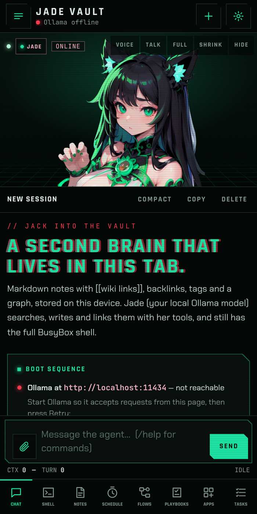
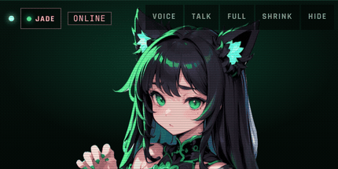
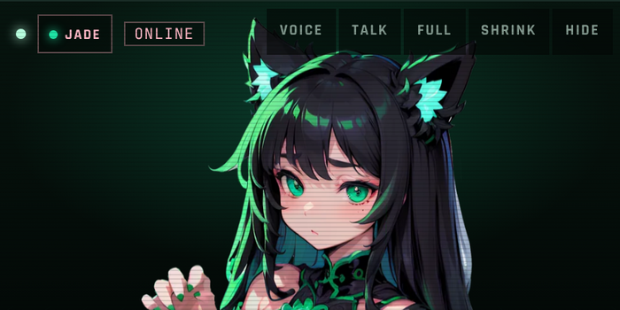
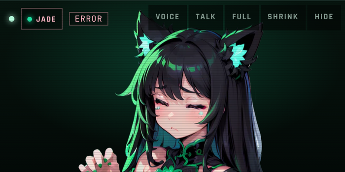
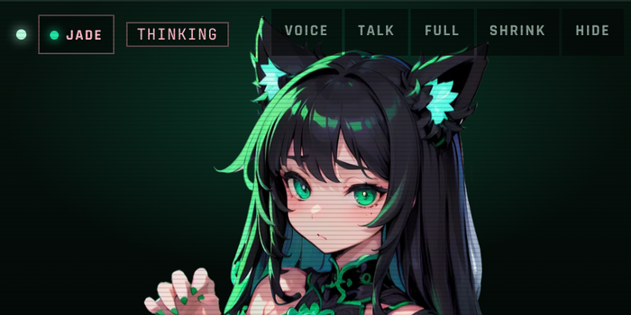
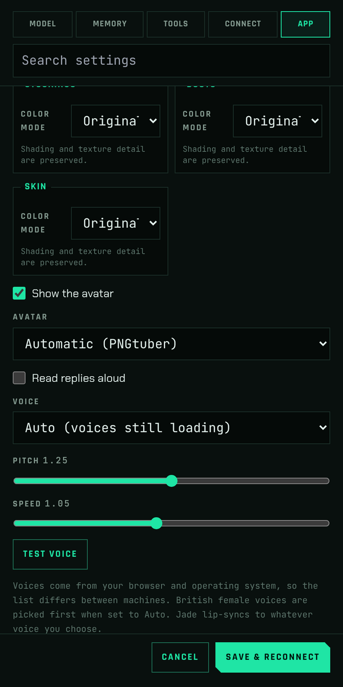

# The PNGtuber avatar

Jade is a **PNGtuber** by default: her companion above the chat is a layered 2D picture that blinks, breathes, nods and
flaps her mouth while she speaks, with five expressions of four frames each. It is light (about 240 kB for all of it),
needs no WebGL and no network, and starts at once. The Live2D model is still there when you want it.



## What it does



The avatar follows the same moods and the same speech as the Live2D model, so nothing else in the app changes:

| Jade is | Mood | Expression |
|---|---|---|
| idle, listening, writing | `idle`, `listening`, `writing` | neutral |
| thinking | `thinking` | shy |
| running tools | `working` | mad |
| done | `happy` | happy |
| something failed | `error` | sad |

| Neutral | Happy | Sad | Mad | Shy |
|---|---|---|---|---|
|  |  |  |  |  |

- **Speaking:** her mouth moves while text-to-speech plays, in time with the voice's loudness; with Voice off it still
  moves when she "speaks" a reply.
- **Idle life:** random blinks, a slow breath, a hop when she is happy, a nod on `Jade.nod()`, and a lean toward your
  finger or pointer.
- **Layouts:** it frames itself for the strip (Shrink), the full view and the portrait view, and follows
  Hide and the hands-free solo screen.

## Choosing the avatar

Open **Config → App → Jade companion → Avatar**.



| Choice | Result |
|---|---|
| **Automatic** (default) | The PNGtuber. If you customise her colours (hair, clothes, stockings, boots), Live2D takes over, because only Live2D can be recoloured part by part. If Live2D fails to start, the PNGtuber is used. |
| **PNGtuber** | Always the PNGtuber. Gemstone themes still tint the page, but her picture keeps its own colours. |
| **Live2D** | Always the Live2D model, as before 2.29. |

The change applies at once, without a reload. In scripts and the console: `Jade.kind` is `'png'` or `'live2d'`, and
`Jade.switchAvatar()` re-reads the setting (`S.jadeAvatar` is `auto`, `png` or `live2d`).

## Making your own PNGtuber

The images come from a folder of PNG frames, one subfolder per expression (`Neutral`, `Happy`, `Sad`, `Mad`, `Shy`),
each with the same four frames per expression named `…1.png` to `…4.png`:

```
python3 app/tools/make_pngtuber.py /path/to/frames
```

The tool finds the region that changes between frames (the face), writes the unchanging body to
`app/avatar/pngtuber/body.webp`, the face cells to `faces.webp` and the layout to `faces.json`, and the build inlines
them. Rebuild with `bash scripts/build-web.sh`.

## Screenshots

`CHROME=/usr/bin/google-chrome node scripts/pngtuber-shots.mjs` regenerates the images on this page from
`dist/jade-vault.html` (it also checks the default, the setting and the switch to Live2D and back).
